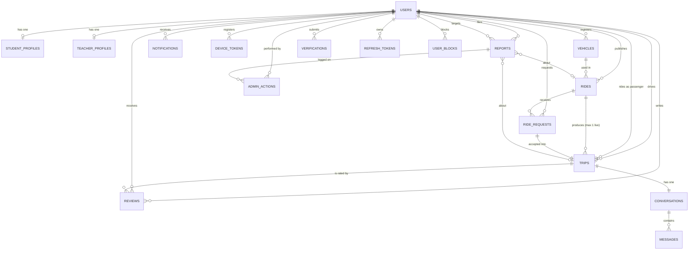

# 2. Database Design — SSUET RideShare

PostgreSQL 16 is the target. SQLAlchemy models are the source of truth
(`backend/app/models`), Alembic owns migrations, and
`database/schema.prisma` mirrors this design for review and visualization.

**18 tables** = 14 required domain entities + 4 auth/safety support tables.

---

## 2.1 Entity–relationship diagram



### Cardinality summary

| From | To | Cardinality | Rule |
|---|---|---|---|
| User | Student/TeacherProfile | 1 : 0..1 | exactly one profile type per role |
| User | Vehicle | 1 : 0..N | a driver may register a car and a bike |
| User | Ride (driver) | 1 : 0..N | one published journey each |
| Ride | RideRequest | 1 : 0..N | many people may ask |
| Ride | Trip | 1 : 0..N, **≤1 live** | partial unique index on `ride_id WHERE status <> 'CANCELLED'` |
| RideRequest | Trip | 1 : 0..1 | unique `request_id` |
| Trip | Conversation | 1 : 1 | unique `trip_id` |
| Conversation | Message | 1 : 0..N | ordered by `created_at` |
| Trip | Review | 1 : 0..2 | unique (`trip_id`,`author_id`) + `author <> subject` |
| User | Report | 1 : 0..N | reporter ≠ reported |

---

## 2.2 Table catalogue

### `users` — identity + trust
| Column | Type | Notes |
|---|---|---|
| `id` | uuid PK | generated in Python |
| `email` | varchar(180) UNIQUE | unique, login identifier |
| `password_hash` | varchar(255) | Argon2id, never plaintext |
| `phone` | varchar(20) UNIQUE | private; released only after matching |
| `full_name` | varchar(120) | CHECK length ≥ 3 |
| `profile_photo_url` | varchar(500) NULL | |
| `role` | varchar(16) | STUDENT / TEACHER / ADMIN |
| `department`, `university_id` | varchar | UNIQUE(`role`,`university_id`) |
| `is_university_email` | bool | set at signup from the domain |
| `verification_status` | varchar(16) | UNVERIFIED/PENDING/VERIFIED/REJECTED |
| `account_status` | varchar(16) | ACTIVE/SUSPENDED/DEACTIVATED |
| `rating_average`, `rating_count`, `completed_trips_count` | float/int | denormalised aggregates, recomputed on review |
| `created_at`, `updated_at`, `deleted_at` | timestamptz | soft delete |

Indexes: `role+account_status`, `verification_status`, unique `email`, unique `phone`.

### `rides` — the published journey
Key columns: `driver_id`, `vehicle_id`, `vehicle_type`, `direction`,
`pickup_area/pickup_latitude/pickup_longitude`,
`destination_area/destination_latitude/destination_longitude`,
`departure_date`, `departure_at`, `available_seats`, `seats_remaining`,
`fuel_preference`, `contribution_type`, `contribution_amount`, `note`, `status`,
plus lifecycle timestamps (`matched_at`, `started_at`, `completed_at`, `cancelled_at`).

Constraints:
* `available_seats BETWEEN 1 AND 8`
* `fuel_preference <> 'SHARE_FUEL' OR contribution_type <> 'NONE'` — you cannot
  advertise cost-sharing without saying how the share is defined
* `contribution_amount >= 0`
* Index `(status, departure_date, direction)` drives the Explore feed
* Index `(departure_at)` drives the auto-expire job

**Privacy split:** `pickup_area` is public ("Gulshan-e-Iqbal"); `pickup_latitude/
longitude` is only serialized after a request is ACCEPTED. The exact meeting
point lives on `trips.meeting_point` — a different table, different permission.

### `ride_requests`
`ride_id`, `passenger_id`, `message`, `status`, `responded_at`, `response_note`.
* Partial unique index `(ride_id, passenger_id) WHERE status='PENDING'` — no
  duplicate spam.
* Indexes on `(ride_id,status)` and `(passenger_id,status)` for the two inboxes.

### `trips` — the confirmed journey
`ride_id`, `request_id` (UNIQUE), `driver_id`, `passenger_id`, `status`,
`meeting_point/lat/lng`, lifecycle timestamps, `cancelled_by_id`,
`cancellation_reason`, four boolean flags (both sides confirm completion, both
sides may review once).

**The one-passenger rule is enforced here:**

```sql
CREATE UNIQUE INDEX uq_trips_one_active_per_ride
    ON trips (ride_id) WHERE status <> 'CANCELLED';
```

Cancelling a trip frees the ride (`MATCHED → OPEN`), and a new request can be
accepted. Two concurrent accepts → the second `INSERT` violates the index →
`409 RIDE_NOT_AVAILABLE`.

### `conversations` / `messages`
`conversations.trip_id` UNIQUE. `messages(conversation_id, created_at)` index for
history paging; `read_at` NULL = unread. Denormalised `last_message_at` /
`last_message_preview` make the chat list one query.

### `notifications` + `device_tokens`
`notifications(user_id, is_read, created_at)` index; `type` is an enum; `data`
is JSON for deep-linking (`{"screen":"trip","trip_id":"…"}`); `push_sent_at`
records delivery attempts. `device_tokens.token` is UNIQUE so re-registering a
device updates instead of duplicating.

### `reviews`
`trip_id`, `author_id`, `subject_id`, `rating 1..5`, `comment`.
UNIQUE(`trip_id`,`author_id`) + CHECK(`author_id <> subject_id`) +
CHECK(rating 1..5). Participation is verified in the service layer because it
needs the trip row.

### `reports`
`reporter_id`, `reported_user_id`, optional `ride_id`/`trip_id`, `category`,
`description`, `status`, `handled_by_id`, `resolution_note`, `resolved_at`.
CHECK reporter ≠ reported.

### `verifications`
Audit trail of every attempt: `verification_type` (UNIVERSITY_EMAIL / STUDENT_ID
/ EMPLOYEE_ID / MANUAL), `status`, `submitted_value`, `document_url`,
`reviewed_by_id/at/note`.

### `admin_actions`
Append-only log: `admin_id`, `action_type`, `target_user_id`, `report_id`,
`entity_type/entity_id`, `notes`. Rendered as the admin "action history".

### Support tables
`student_profiles`, `teacher_profiles` (role-specific data, 1:1),
`refresh_tokens` (SHA-256 hashes + rotation chain), `password_reset_tokens`,
`user_blocks` (UNIQUE(blocker, blocked)).

---

## 2.3 Status machines

```
RIDE            OPEN ──accept──► MATCHED ──start──► IN_PROGRESS ──complete──► COMPLETED
                 │  ▲               │
        cancel / expire            └──cancel──► CANCELLED
                 └──► CANCELLED / EXPIRED        (MATCHED → OPEN when the trip is cancelled)

REQUEST         PENDING ──► ACCEPTED | REJECTED | CANCELLED

TRIP            CONFIRMED ──► IN_PROGRESS ──► COMPLETED
                     │              │
                     ├──► CANCELLED ┘
                     └──► NO_SHOW
```
Transitions are declared once in `app/models/enums.py`
(`RIDE_STATUS_TRANSITIONS`, `TRIP_STATUS_TRANSITIONS`) and checked by services, so
an invalid transition is a `409` rather than a silent data corruption.

---

## 2.4 Transactions & concurrency

| Operation | Transaction strategy |
|---|---|
| Accept request (seat reservation) | `BEGIN` → `SELECT ride FOR UPDATE` → validate → insert trip/accept/notify → `COMMIT`; partial unique index as the final guard |
| Cancel trip | lock trip, lock ride, set statuses, reopen ride, notify — one transaction |
| Review submission | insert review + recompute subject aggregates in one transaction |
| Admin verification | update user/vehicle + insert `admin_actions` + notification in one transaction |
| Chat message | insert message + update conversation denormalised columns in one transaction |

SQLite note: `PRAGMA foreign_keys=ON` is set on connect so tests exercise real FK
enforcement even without PostgreSQL.

---

## 2.5 Index & performance plan

| Query | Index |
|---|---|
| Explore rides by date/direction | `rides(status, departure_date, direction)` |
| Driver's dashboard | `rides(driver_id, status)` |
| Requests inbox | `ride_requests(ride_id, status)`, `ride_requests(passenger_id, status)` |
| Passenger trips | `trips(passenger_id, status)` |
| Chat history | `messages(conversation_id, created_at)` |
| Unread notifications | `notifications(user_id, is_read, created_at)` |
| Admin user list | `users(role, account_status)` |
| Complaint queue | `reports(status, created_at)` |
| Ratings on a profile | `reviews(subject_id, created_at)` |

`EXPLAIN`-worthy additions for later: trigram index on `rides.pickup_area` if
free-text area search grows beyond Karachi-scale data.

---

## 2.6 Keeping Prisma and Alembic honest

1. Alembic is the **only** migration engine that touches a real database.
2. `schema.prisma` is documentation: update it in the same PR as the SQLAlchemy
   model change.
3. CI check (Phase 8): `alembic check` must report "no new upgrade operations",
   i.e. models and migrations agree.
4. Never run `prisma migrate` against the app database.
