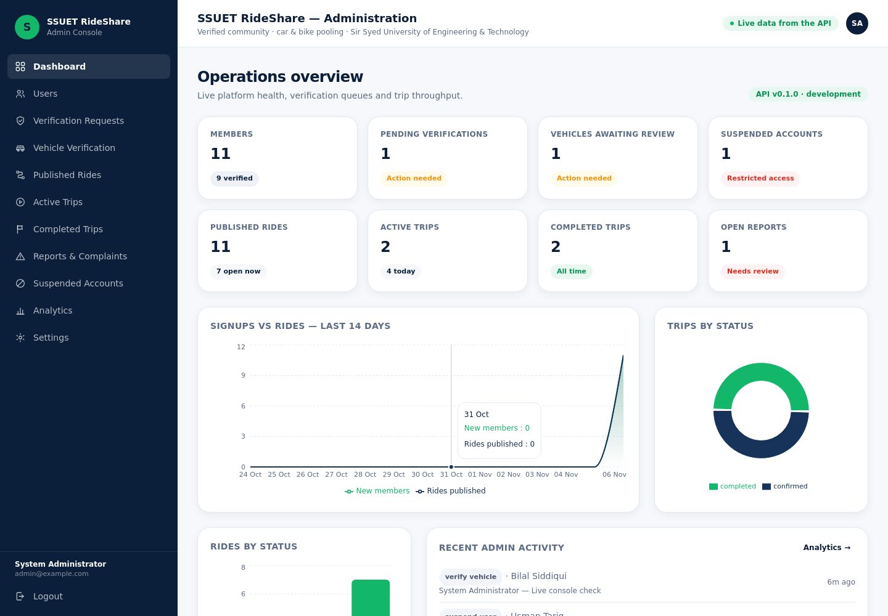
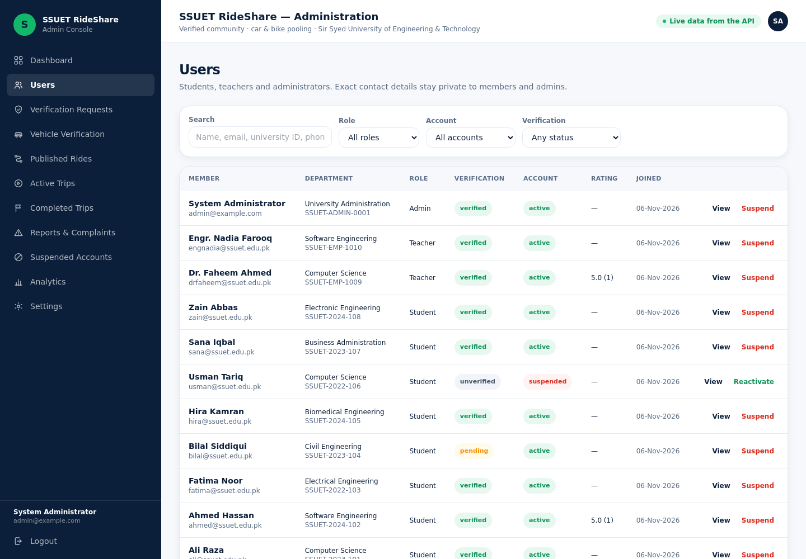
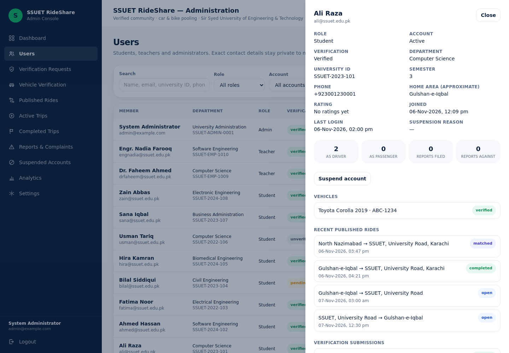
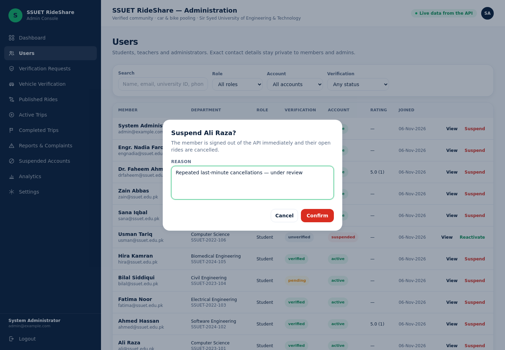
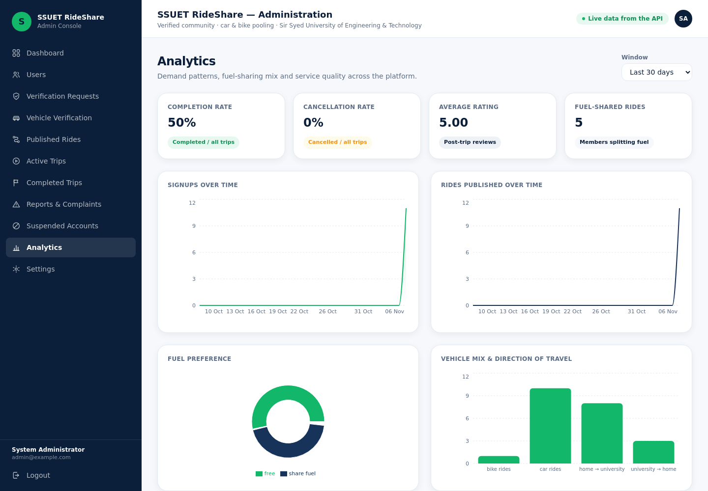
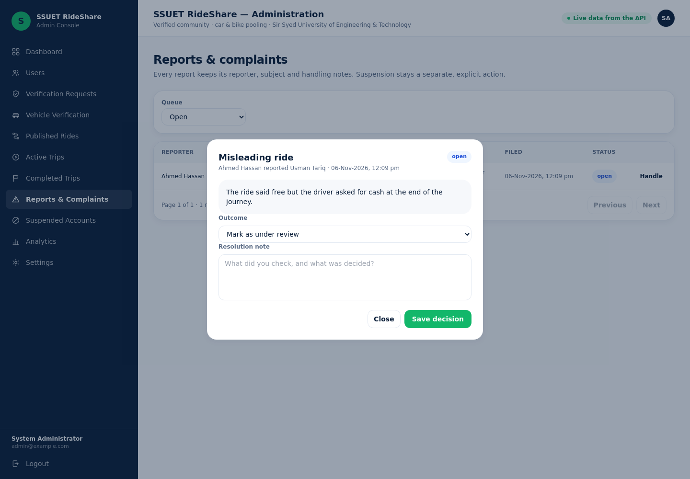

# Phase 6 — Admin Dashboard

The admin console is the operations room of SSUET RideShare: verification queues,
member decisions, ride oversight, complaints and analytics — all reading and writing
the **same FastAPI backend** the mobile app uses. Nothing is mocked, nothing is
computed in the browser.

**Status:** complete. `pytest` → 240 passing, dashboard `tsc --noEmit` clean,
`npm run build` OK, and every `/admin/*` route verified live against the dev
database through both `curl` and the running console.

---

## 1. Backend: the admin surface

| File | Purpose |
| --- | --- |
| `app/schemas/admin.py` | `Page[T]` envelope, `DashboardOut`, `AnalyticsOut`, per-entity row schemas, `AdminUserDetail`, `AdminActionRow`, `AdminReasonIn`, `ReportUpdateIn`, `SettingsOut`. |
| `app/services/admin_service.py` | All aggregation and mutation logic. Every decision writes an `AdminAction` row and notifies the affected member. |
| `app/api/v1/admin.py` | 20 routes behind the `AdminUser` dependency. Thin handlers only — no business logic in the router. |
| `app/services/notification_service.py` | New templates: `ACCOUNT_VERIFIED`, `ACCOUNT_SUSPENDED`, `ACCOUNT_REACTIVATED`, `VEHICLE_VERIFIED`, `VEHICLE_REJECTED`, `NEW_REVIEW`. |

### 1.1 Authorisation

`AdminUser` (in `app/api/deps.py`) resolves the JWT and then re-reads the user row.
A token minted before a suspension **cannot** be used: the role and
`account_status` are checked from the database on every request. Members receive
`403`, anonymous callers `401` — both exercised by tests
(`test_admin_endpoints_require_authentication`, `test_members_cannot_reach_the_console`).

### 1.2 Endpoints

| Method | Path | Notes |
| --- | --- | --- |
| `GET` | `/admin/dashboard` | Stat cards + 14-day series + status breakdowns (`rides_by_status`, `trips_by_status`). |
| `GET` | `/admin/analytics?days=7..180` | Growth series, completion/cancellation rate, average rating, fuel/vehicle/direction splits, top pickup areas and destinations. |
| `GET` | `/admin/settings` | Effective runtime flags (**booleans only**, never secrets) + limits. |
| `GET` | `/admin/users` | `search`, `role`, `status`, `verification`, `page`, `limit`. |
| `GET` | `/admin/users/{id}` | Dossier: profile, vehicles, recent rides, verification submissions, trip/report counters, approximate home area. |
| `POST` | `/admin/users/{id}/verify` | Approve membership; `409` if already verified. |
| `POST` | `/admin/users/{id}/reject` | Requires a reason. |
| `POST` | `/admin/users/{id}/suspend` | Requires a reason; cancels the member's open rides; `409` for admins. |
| `POST` | `/admin/users/{id}/reactivate` | Restores access. |
| `GET` | `/admin/verifications?status=PENDING` | Verification queue with submitted value + document link. |
| `GET` | `/admin/vehicles` | `status`, `search` (registration number, model, owner). |
| `POST` | `/admin/vehicles/{id}/verify` \| `/reject` | Rejection requires a note that the owner sees. |
| `GET` | `/admin/rides` | `status`, `direction`, `search`, `date_from`, `date_to`, `driver_id`. |
| `POST` | `/admin/rides/{id}/cancel` | Force-cancels the ride **and** its trips; both participants are notified. |
| `GET` | `/admin/trips` | `status` or `active_only=true`. |
| `GET` | `/admin/reports` | `status`, `category`. |
| `GET`/`PATCH` | `/admin/reports/{id}` | Resolution requires a note unless moving to `UNDER_REVIEW`. |
| `GET` | `/admin/admin-actions` | Immutable audit log, newest first. |
| `GET` | `/admin/ping` | Guard check used by the console header. |

### 1.3 Business rules enforced server-side

* Admins cannot be suspended, rejected or otherwise locked out (`409`).
* Suspending a driver cancels their still-open rides so no passenger is stranded.
* Force-cancelling a ride cascades to its trips and notifies the passenger.
* Vehicle approval is a prerequisite for publishing rides (Phase 3 rule, unchanged).
* Every mutation appends to `admin_actions` with the acting admin, target, note and
  timestamp — `test_every_mutation_is_audited` asserts this for two different actions.
* `GET /admin/settings` never serialises a key, password or JWT secret;
  a test flattens the payload and greps for `jwt`, `password`, `secret`.

---

## 2. Dashboard: the console

```
admin-dashboard/src/
  api/admin.ts               typed hooks for all 20 endpoints + mutations with cache invalidation
  api/client.ts              axios instance, bearer token, error normaliser
  components/ui/index.tsx     PageHeader, StatCard, StatusBadge, TableShell, Pagination,
                             ReasonDialog, Filters, Field, InlineError
  components/layout/         AppLayout (header + outlet), Sidebar (§16 structure, no phase pills)
  lib/format.ts              date/relative/label formatting (presentation only)
  pages/Dashboard.tsx        stat cards, signups-vs-rides area chart, status doughnut/bar, recent activity
  pages/Users.tsx            searchable directory + dossier drawer + verify/reject/suspend/reactivate
  pages/Verifications.tsx    pending queue with approve/reject
  pages/Vehicles.tsx         queue with status filter, search, approve/reject
  pages/Rides.tsx            filters + force cancel
  pages/Trips.tsx            one component, `mode="active" | "completed"`
  pages/Reports.tsx          complaint queue + handling dialog
  pages/Suspended.tsx        suspended accounts + reactivate
  pages/Analytics.tsx        Recharts growth/quality charts + full action history table
  pages/Settings.tsx         read-only configuration and service health
  pages/NotFound.tsx         honest 404 for unknown console URLs
```

Design decisions:

* **No fake numbers.** Every figure is a response field. When a request fails the
  table shows the API error; when a list is empty it explains what will appear there.
* **Reasons are mandatory where the API requires them.** The `ReasonDialog` requires
  ≥ 3 characters before the confirm button enables, mirroring the server-side rule, so
  the console can never send a request it knows will 422.
* **Loading/empty/error states are first-class** (`TableShell` renders all three).
* **Cache invalidation is centralised** in `useAdminMutation`: after any decision the
  list, the dashboard counters and the audit log refetch together, so the UI never
  drifts from the database.
* **Sidebar structure matches §16 exactly** and the `P6` badges are gone; the header
  now shows a live-data indicator instead of a phase label.

---

## 3. Verification performed

```
backend$  python -m pytest                 → 240 passed   (38 new admin tests)
admin-dashboard$ npx tsc --noEmit          → clean
admin-dashboard$ npm run build             → ✓ built, 573 modules
```

Browser smoke test (headless Chromium against the running console, zero console errors):
login → Dashboard → Users → Analytics → Published rides → Vehicle verification →
Reports → Settings, plus the user dossier drawer, the reason-mandatory dialogs and
the report handling dialog. Screenshots in
[`screenshots/`](screenshots) (`shot-dashboard`, `shot-users`, `shot-user-drawer`,
`shot-analytics`, `shot-rides`, `shot-vehicles`, `shot-reports`, `shot-settings`,
`shot-reason-dialog`, `shot-report-dialog`).

Live, against the seeded dev database (`http://127.0.0.1:8000`, console `:5173`):

```
login: 200 ADMIN
member hits /admin/dashboard: 403
dashboard: 200 {"active_trips":2,"completed_trips":2,"open_reports":1,"open_rides":7,
                "pending_vehicles":2,"pending_verifications":1,"published_rides":11,
                "rides_today":11,"suspended_accounts":1,"total_users":11,
                "trips_today":4,"verified_users":9}
  series lengths: {'users_per_day':14,'rides_per_day':14,'trips_per_day':14}
  rides_by_status: {'COMPLETED':2,'MATCHED':2,'OPEN':7} | trips_by_status: {'COMPLETED':2,'CONFIRMED':2}
analytics: 200 {'completion_rate':50.0,'cancellation_rate':0.0,'average_rating':5.0}
  areas: [{'area':'Gulshan-e-Iqbal','count':5},{'area':'SSUET, University Road','count':3}, ...]
users: 200 11 | first: System Administrator VERIFIED
dossier: 200 vehicles 0 rides 0 trips_as_driver 0
verifications pending: 200 1      vehicles pending: 200 2      open rides: 200 7
active trips: 200 2                reports: 200 1
settings: 200 development maps False
verify vehicle: 200 VERIFIED | note: Live console check   →  pending after: 1
audit log: 200 2 [('VERIFY_VEHICLE','Bilal Siddiqui','System Administrator'), ('SUSPEND_USER','Usman Tariq', None)]
```

The last two lines matter most: a real decision changed the queue **and** appended an
audit row attributed to the signed-in administrator.

---

## 3.1 Screens

| Screen | What it proves |
| --- | --- |
|  | Counters, 14-day signups-vs-rides area chart, trip-status doughnut, rides-by-status bars, recent audit entries — all from `/admin/dashboard`. |
|  | Directory with search/filters, verification + account badges, rating column, per-row actions. |
|  | Member dossier: profile, approximate home area, trip/report counters, vehicles, recent rides with live statuses, verification submissions. |
|  | Destructive actions require a written reason — the confirm button stays disabled until it is given, matching the API rule. |
|  | Completion/cancellation rate, average rating, fuel mix, vehicle/direction mix, top areas, action history. |
|  | Complaint handling with under-review / resolve / dismiss and a mandatory resolution note. |

## 4. Running it

```bash
# 1. API (terminal 1)
cd backend
python -m uvicorn app.main:app --host 0.0.0.0 --port 8000

# 2. Console (terminal 2)
cd admin-dashboard
npm install
npm run dev            # http://localhost:5173
```

Sign in with the bootstrap administrator from `backend/.env`
(`ADMIN_EMAIL` / `ADMIN_PASSWORD`; dev default `admin@example.com` / `Admin@SSUET2026`).
The dev server proxies `/api` to `VITE_PROXY_TARGET` (default `http://127.0.0.1:8000`),
so the browser only ever talks to one origin.

To populate a realistic dataset:

```bash
cd backend && python -m scripts.seed
```

---

## 5. What Phase 7 adds

Reviews & ratings are already modelled and the admin analytics reads
`rating_average`/`rating_count`; Phase 7 completes the member-facing review flow,
report/block endpoints from the mobile app, and the trust score that feeds the
`NEW_REVIEW` notification template added here.
