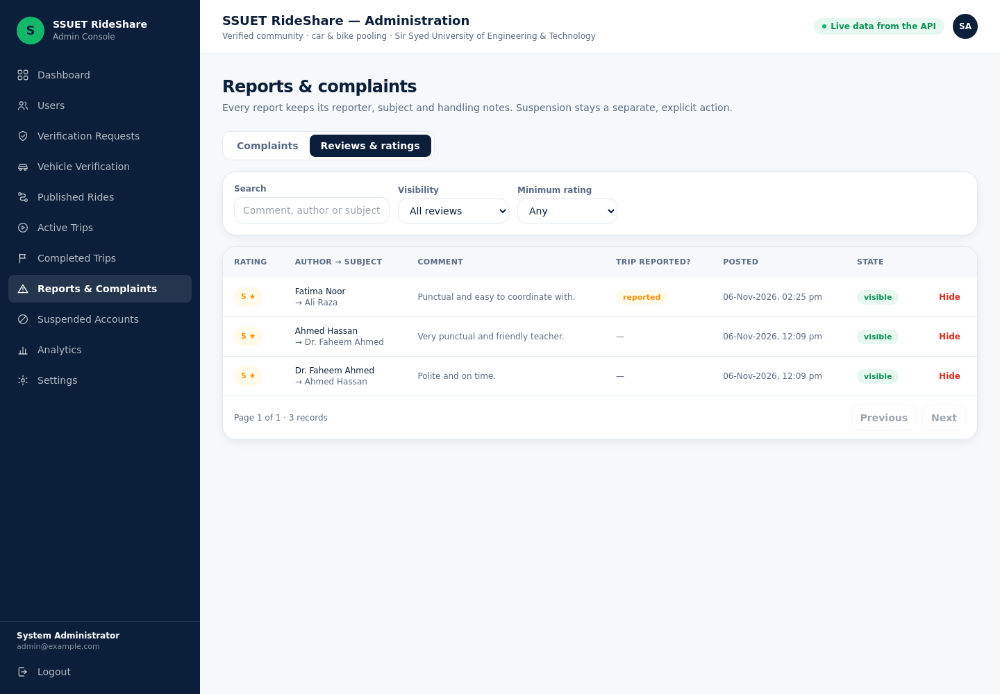

# Phase 7 — Trust & Quality

Phase 7 closes the loop that makes pooling safe in a community where **no money
changes hands**: members rate each other after a real trip, anyone can report a
problem, blocked pairs can never interact again, an administrator can hide an
abusive review, and the privacy promises are now enforced by a regression suite
rather than by good intentions.

**Status:** complete. `pytest` → **304 passing** (64 new), mobile `tsc` clean and
`expo export --platform android` → **4.18 MB**, dashboard `tsc` + `npm run build`
clean, and the whole loop verified live against the running API.

---

## 1. Reviews & ratings (§14)

| File | Purpose |
| --- | --- |
| `app/schemas/review.py` | `ReviewIn` (1–5 + optional comment), `ReviewOut`, `ReviewPage` (with average + 5-star breakdown), `PendingReviewOut`. |
| `app/services/review_service.py` | Eligibility rules, aggregate recomputation, pending list, moderation helper. |
| `app/api/v1/reviews.py` | Four routes, the write path rate-limited to `10/minute`. |
| `app/schemas/admin.py` + `admin_service.py` | `AdminReviewRow`, `list_reviews`, `moderate_review`. |

```
POST /reviews/trips/{trip_id}       rate the other participant of a completed trip
GET  /reviews/pending               finished trips I still owe a rating for
GET  /reviews/me/received           reviews about me (average + breakdown)
GET  /reviews/users/{user_id}       reviews about any member
GET  /admin/reviews                 moderation feed (hidden included, searchable)
POST /admin/reviews/{id}/hide|unhide
```

Rules enforced server-side:

* **Completed trips only** — rating a `CONFIRMED` trip returns `409`.
* **Participants only** — a stranger gets `403`, even with a valid trip id.
* **One review per side** — the trip row carries `driver_reviewed_passenger` /
  `passenger_reviewed_driver`, and `uq_reviews_trip_author` is the database-level
  backstop for two devices submitting simultaneously (`409`).
* **Aggregates are recomputed, never incremented** — `recompute_rating()` runs an
  `AVG`/`COUNT` over the visible rows after every write and after every moderation
  decision, so `users.rating_average` can never drift and hidden reviews drop out.
* **Comments are cleaned** — whitespace collapsed, `3–500` characters, "ok" is
  rejected so a comment always carries meaning.
* The subject is notified (`NEW_REVIEW`) with the trip id attached; the author's
  phone and email are never part of the payload.

## 2. Reports, complaints & blocking (§15)

| File | Purpose |
| --- | --- |
| `app/schemas/report.py` | `ReportIn` (category + 10–1000 chars + optional trip/ride/member), `ReportOut`, `ReportPage`. |
| `app/services/report_service.py` | Target resolution and validation, duplicate guard, notifications. |
| `app/api/v1/reports.py` | File, list mine, read one — `5/minute` on filing. |
| `app/api/v1/users.py` | Block / unblock / list blocked (already present, now covered by tests). |

```
POST /reports                 file a report (category, description, trip/ride/member)
GET  /reports?status=         reports I filed, newest first
GET  /reports/{id}            one of mine, including the office's decision
```

Who may be reported is **derived, not trusted**:

* with a `trip_id`, the API proves the reporter was on that trip and the subject is
  the *other* participant — a mismatched `reported_user_id` is `422`;
* with a `ride_id`, the subject must be the driver or somebody who requested it;
* self-reports are rejected, and a second **open** report for the same pair is
  `409` (a new report is allowed once the previous one is closed).

Lifecycle: `OPEN → UNDER_REVIEW → RESOLVED | DISMISSED`. The reporter is
acknowledged (`REPORT_RECEIVED`), every active admin gets a system notification,
and when the office resolves a report the reporter receives `REPORT_RESOLVED` with
the written note — visible both in the app and in `/reports/{id}`.

Blocking already removed a member from Explore, from new requests and from chat;
Phase 7 pins that behaviour with tests so it can never regress.

## 3. Security & privacy hardening (§8, §19, §26.9)

`backend/tests/test_security.py` (19 tests) is the regression net for two promises:

**Privacy before matching** — a test walks every key of the Explore feed, ride
detail and public profile payloads and fails if any of `phone`, `email`,
`home_address`, `home_latitude`, `home_longitude`, `meeting_point`,
`meeting_latitude`, `meeting_longitude`, `university_id` appears. Your *own*
`/auth/me` legitimately still shows your phone.

**Authorisation on every id** — knowing an id is never enough:

| Attack | Result |
| --- | --- |
| `GET /trips/{id}` as a stranger | `403/404` |
| start / no-show / complete somebody's trip | `403/404` |
| read or post in another conversation, or open its history | `403/404` |
| mark somebody else's notification read | `404` |
| publish a ride with another member's vehicle | `403/404/422` |
| accept a request you do not own | `403/404` |
| request a seat on your own ride | `400/403/409/422` |
| use the API after suspension | `403` everywhere |
| malformed / unknown ids | `404` or `422`, never `500` |
| error bodies | documented envelope, no traceback or SQL in the response |

Rate limits now cover the new write paths: reviews `10/min`, reports `5/min`
(alongside the existing auth limits).

## 4. Mobile

| Screen | What it does |
| --- | --- |
| `app/review/[tripId].tsx` | Modal: big 1–5 star selector, optional 500-char comment, submits once and closes. Explains that only the first name and department are shown. |
| `app/report/[tripId].tsx` | Modal: six categories with hints, free-text description, submits with the trip id so the API validates the subject. |
| `app/reviews.tsx` | My ratings: average + 5-star distribution bars + every review received. |
| `app/my-reports.tsx` | Reports I filed with status and the office's resolution note. |
| `app/blocked.tsx` | Members I blocked, with one-tap unblock. |
| `app/trip/[id].tsx` | "Rate your trip" card after completion, "Report a problem" and "Block member" actions, and a completion alert that offers *Rate now*. |
| `app/(tabs)/index.tsx` | Home shows a "Rate your last trip" prompt while a rating is owed. |
| `app/(tabs)/profile.tsx` | New **Trust & safety** section linking My ratings, My reports and Blocked members. |

API clients: `src/api/reviews.ts` and `src/api/reports.ts`
(including the category list with human-readable hints).

## 5. Admin console

`Reports & Complaints` gained a **Reviews & ratings** tab: search by comment,
author or subject, filter by visibility and minimum rating, and hide/restore a
review with a mandatory reason. Hiding recomputes the subject's average
server-side, so the public profile really changes — and the decision is written to
`admin_actions` (`HIDE_REVIEW` / `UNHIDE_REVIEW`).



## 6. Verification

```
backend$          python -m pytest → 304 passed
mobile$           npx tsc --noEmit → clean ; expo export → 4.18 MB HBC
admin-dashboard$  npx tsc --noEmit → clean ; npm run build → ✓
```

Live run against the seeded database (`http://127.0.0.1:8000`):

```
== pending ratings ==
ahmed: 200 count=0 []          fatima: 200 count=1 [('Ali Raza', 'PASSENGER')]
== submit review ==
submit: 201 5 | Punctual and easy to coordinate with.
duplicate: 409 You have already rated this trip.
== aggregate moved ==
counterpart reviews: 200 total 1 avg 5.0 breakdown {'5': 1, '4': 0, '3': 0, '2': 0, '1': 0}
public profile: 5.0 / 1 | leaks phone? False
== trip payload ==
trip: 200 can_review False viewer_reviewed True
== report a problem ==
file report: 201 OPEN against Ali Raza     my reports: 200 1     admin queue: 200 2
== office resolves ==
resolve: 200 RESOLVED | True
reporter notified: ['REPORT_RECEIVED', 'REPORT_RESOLVED', ...]
== moderation: hide the review ==
hide: 200 True     after hide → total 0 avg 0.0
unhide: 200 False  after unhide → total 1 avg 5.0
== privacy sweep on explore ==
explore items: 7 | leaked keys: none
```

Browser check of the console's moderation tab (headless Chromium): 4 real reviews
listed, zero console errors.

## 7. What Phase 8 covers

End-to-end journey tests across all three components, a coverage report, load
sanity on Explore, the physical-device pass on a preview APK, EAS `preview`/`production`
profiles, splash/icon assets and the final documentation set (setup, API, ER,
testing, admin runbook).
